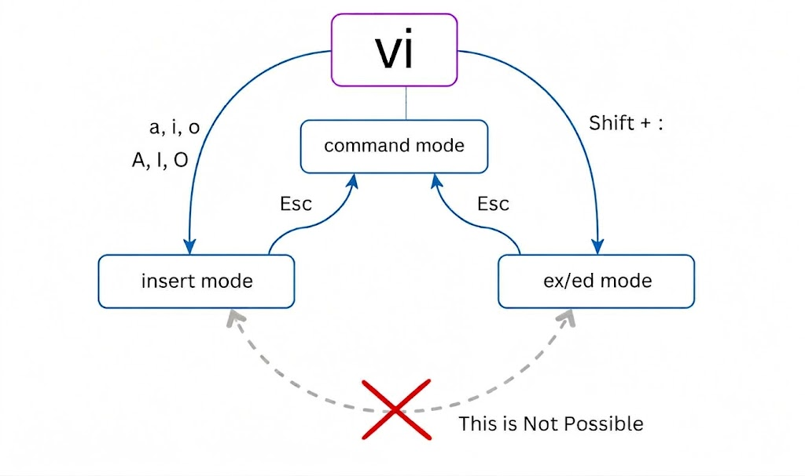
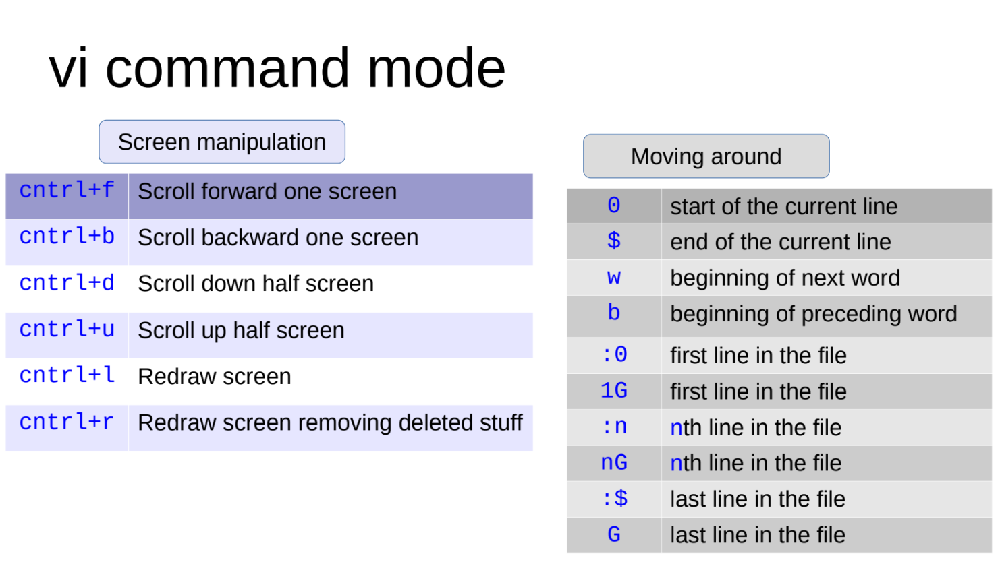
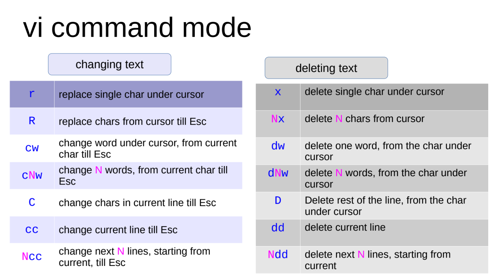
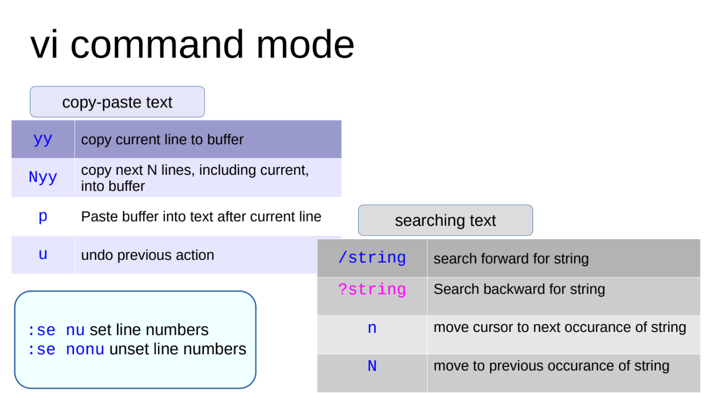
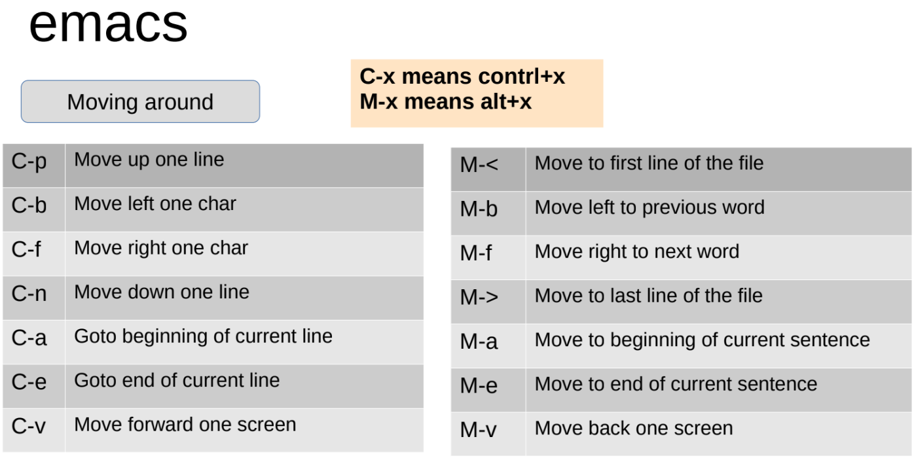
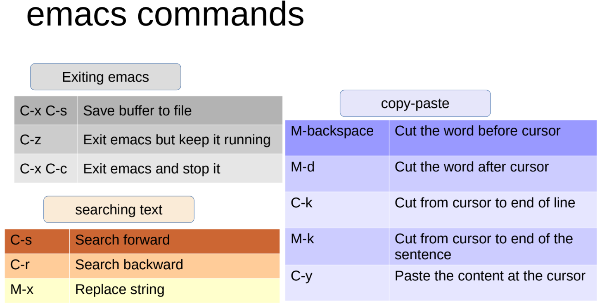
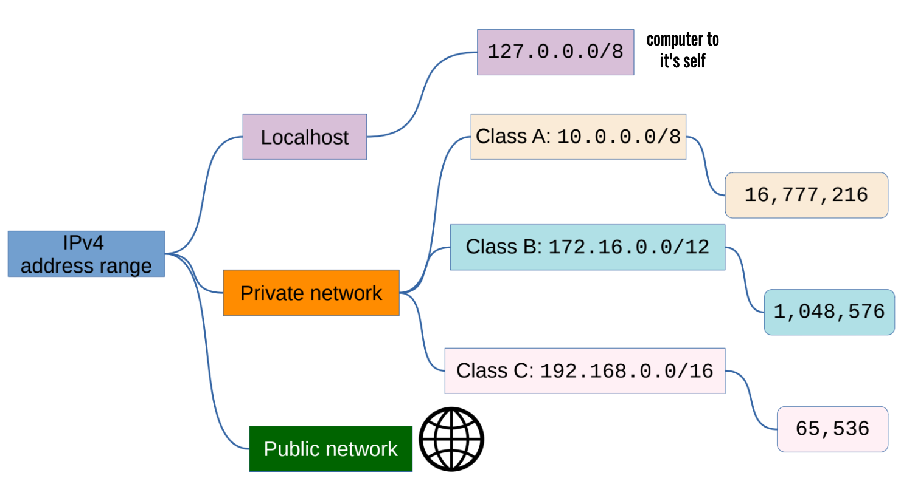

# Linux CLI Editors
<div style="text-align: left;">

</div>

## **ed** Editor
Old editor but avilable in all linux-unix systems, usefull if no option is avilable.
### File & Shell Operations

| Command | Description |
| --- | --- |
| `P` | Show the prompt (toggles the primary prompt)|
| `[addr[,addr]]cmd[params]` | Command Format (optional addresses, command, and parameters)|
| `!command` | Execute a shell command|
| `e filename` | Edit a file|
| `r filename` | Read file contents into buffer|
| `r !command` | Read command output into buffer|
| `w filename` | Write buffer to file|
|`2` `.` `$` `%` `+` `-` `,` `;` `/RE/`| Commands for location (of cursor)|
|`f` `p` `a` `c` `d` `i` `j` `s` `m` `u`|Editing commands|
| `q` | Quit|

### Location Commands

| Symbol | Description |
| --- | --- |
| `2` | A specific line number (in this example, line 2)|
| `.` | The current line address|
| `$` | The last line of the buffer|
| `%` | Shorthand for the entire file range (`1,$`)|
| `+` | Forward relative line offset (e.g., next line)|
| `-` | Backward relative line offset (e.g., previous line)|
| `,` | Separator for a line range (from first to second address)|
| `;` | Separator for a line range, setting current line (`.`) to the first address first|
| `/RE/` | Searches forward for a line matching the Regular Expression pattern (`RE`)|

---

### Editing Commands

| Command | Example | Description |
| --- | --- | --- |
| `f` |f document.txt | Show name of file being edited|
| `p` |1,5p | Print the current line|
| `a` |2a | Append at the current line|
| `c` |1,3c | Change the line|
| `d` |2d | Delete the current line|
| `i` |3i | Insert line at the current position|
| `j` |1,3j | Join lines|
| `s` |s/hello/ | Search for regex pattern|
| `m` |4,5m1 | Move current line to position|
| `u` |u | Undo latest change|
---
## **nano** Editor
Nano is a command-line text editor that comes pre-installed with most Linux distributions. It's designed to be user-friendly, with a simple interface that resembles popular graphical text editors. Nano provides essential editing features, making it ideal for quick edits, creating configuration files, or writing scripts directly in the terminal, blow is link for cheatsheet of nano.
### [nano cheatsheet](https://www.nano-editor.org/dist/latest/cheatsheet.html)
---

## **vi** Editor
The **vi** editor (Visual Editor) is a powerful, lightweight, terminal-based text editor pre-installed on almost every Linux and Unix-like operating system. Created by Bill Joy in 1976, it is highly resource-efficient and essential for managing servers or writing scripts where a graphical user interface (GUI) isn't available. On most modern Linux distributions, running vi opens **Vim** (Vi Improved), an upgraded version that supports enhanced features like syntax highlighting.

### [more on vim](https://vimhelp.org/)
- `vi`or`vim` Default in `command mode` while `ex/ed mode` commands are as above in `ed editor`.
<div style="text-align: left;">

</div>
<div style="text-align: left;">

</div>
<div style="text-align: left;">

</div>

- Also all those in **ed editor** like: `%s/search/replace/` (replace only first occurence in each line) OR `%s/search/replace/g` (globally all occurence in all lines)
<div style="text-align: left;">

</div>
<div style="text-align: left;">

</div>

## **emacs** Editor
It is not required to know both the editors, those who find `vi` hard can use `emacs` or other.
<div style="text-align: left;">

</div>
<div style="text-align: left;">

</div>

---

# Network & ssh
Accessing remote machines on command line.
<div style="text-align: left;">

</div>

## Ways to gain remote access
- VPN access
- ssh tunneling
- Remote desktop : x2go, rdp, pcoip,
- Desktop over browser: Apache Guacomole
- Commercial, over internet : Teamviewer, AnyDesk,Zoho assist, ...

## Some important ports
|Port Number | Name | Discription |
| --- | --- | --- |
| 21 | ftp | File transfer |
| 22 | ssh | Secure Shell |
| 25 | smtp | Simple Mail Transfer Protocol |
| 80 | http | Hypertext Tranfer Protocol |
| 443 | https | Secure Hypertext Tranfer Protocol |
| 631 | cups | Common Unix Printing System |
| 3306 | mysql | MySQL database (differ with software) |

## SELinux
SELinux (Security-Enhanced Linux) is a mandatory access control (MAC) security system built into the Linux kernel that enforces strict policies to control what users and programs can access, preventing unauthorized actions even if a process is compromised.

- **SELinux is recommended for all publicly visible servers**
- Ubuntu uses **AppArmor** as its default MAC system, but you can install SELinux manually
- Security Enhanced Linux mode available on Ubuntu too,
- apart from server grade flavors like CentOS, Fedora,
- RHEL, SuSE Linux etc.,
- Additional layer of access control on files to services
- Role Based Access Control
- Process sandboxing, least privilege access for subjects
- Check using `ls -lZ` and `ps -eZ`
- RBAC items: user (unconfined_u), role(object_r), type (user_home_t), level (s0)
- Modes: disabled, enforcing, permissive
- Tools: semanage, restorecon

## Network tools
|Tools | Discription |
| --- | --- |
| ping |  To see if the remote machine is up |
| ifconfig -a | all network interfaces (active and inactive) |
| traceroute |  Diagnostics the hop timings to the remote machine |
| nslookup |  Ask for conversion of IP address to name |
| dig |  DNS lookup utility |
| netstat |  Print network connections |
| mxtoolbox.com |  For help with accessibility from public network |
| whois lookup |  Who owns which domain name |
| nmap |  (careful !) Network port scanner |
| wireshark |  (careful !) Network protocol analyzer |

- `ping` : Checks whether a remote machine is reachable and measures round-trip response time.
  - Use case: Check whether a server is responding or troubleshoot connectivity.
  ```
  ping -c 4 google.com
  # Sends 4 ping requests and displays response times and packet loss
  ```
- `ifconfig -a` : Used in Linux to configure and manage network interfaces. It provides detailed information about active and inactive interfaces, including IP addresses, netmasks, and MAC addresses.

- `traceroute` : Shows the network hops packets take to reach a destination and the response time at each hop.
  - Use case: Identify where network delays or routing issues may occur.
  ```
  traceroute google.com
  # Displays the route taken to reach google.com
  ```
- `nslookup` : Queries DNS to find the IP address associated with a domain or the domain associated with an IP address.
  - Use case: Troubleshoot DNS resolution problems.
  ```
  nslookup google.com
  # Displays the DNS records returned for google.com, commonly including its IP addresses
  ```
- `dig` : Performs detailed DNS queries for records such as A, AAAA, MX, NS, and TXT.
  - Use case: Investigate DNS configuration and troubleshoot domain resolution.
  ```
  dig google.com A
  # Queries the A record to find IPv4 addresses for google.com
  ```
- `netstat` : Displays network connections, listening ports, routing tables, and network statistics.
  - Use case: Check active connections or identify services listening on ports.
  ```
  netstat -tuln
  # Shows listening TCP/UDP ports and numeric addresses on Linux
  ```
- `mxtoolbox.com` : An online collection of tools for checking DNS records, email configuration, blacklists, and network-related issues.
  - Use case: Troubleshoot email delivery, MX records, DNS configuration, and public service availability.
  ```
  https://mxtoolbox.com/
  # Open the website and enter a domain to check its DNS or mail server configuration
  ```
- `whois lookup` : Retrieves domain registration information, such as registrar, registration dates, and nameservers, when publicly available.
  - Use case: Find out which registrar manages a domain and review its registration details.
  ```
  whois example.com
  # Displays available WHOIS registration information for example.com
  ```
- `nmap` : Scans hosts and ports to discover network services and assess network exposure. Use only on systems you own or have permission to test.
  - Use case: Check which ports are open on your own server.
  ```
  nmap -sV 192.168.1.10
  # Scans the target's ports and attempts to identify running service versions
  ```
- `wireshark` : A graphical network protocol analyzer that captures and inspects packets traveling across a network.
  - Use case: Troubleshoot connection failures, DNS problems, retransmissions, and protocol-level issues.
  ```
  wireshark
  # Opens Wireshark; select an authorized network interface to capture traffic
  ```
### Quick notes
- `ping` and `traceroute` may be blocked by firewalls, so a failed response does not always mean the destination is down.
- `traceroute` may be named `tracepath` on Linux or `tracert` on Windows.
- `netstat` may not be installed by default on newer Linux systems; `ss -tuln` is a common alternative.
- `nmap` and `wireshark` should be used responsibly and only on networks you are authorized to inspect.