# Combining commands and files
## Executing multiple commands
Command could be a script or normal command
- Run multiple commands 
```bash
command1; command2; command3;
# Each command will be executed one after other
date; ls /usr/bin;
```
- Run another command if first runs sucessfully (returns 0 - success)
```bash
command1 && command2
# command2 will be executed only if command1 succeeds
sudo apt install vim && man vim
```
- Run either a command to do the task
```bash
command1 || command2
# command2 will not be executed if command1 succeeds
apt install vim || sudo apt install vim
```
## File descriptors
A file descriptor (FD) is a non-negative integer that the operating system assigns to a process when it opens a file, socket, pipe, or any I/O resource. It acts as a handle for the process to perform operations like read, write, or close without knowing the underlying device details.
- As shown in the blow picture each `stdin`, `stdout` and `stderr` are usually correspond to keyboard or moniter but we can deliver the content of `stdout` and `stderr` to some file or to other command (pipe) or take input `stdin` from file or output of some other cammands.
- Rember : Use `>` to write/overrite file and use `>>` for appending to file.
<div style="text-align: left;">
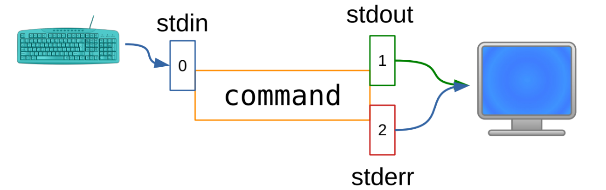
</div>

1. **`command > file1`** : Using `>` we can transfer the output of command to file1, override the fiel1 if exist already.

    ```bash
    # Example
    ls /usr/bin > list_file.txt
    ```
    <div style="text-align: left;">
    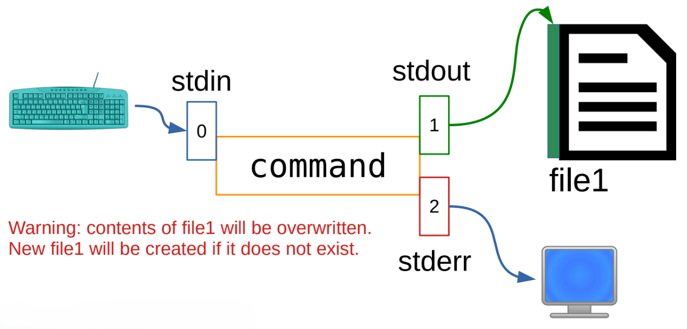
    </div>

2. **`command >> file1`** : Using `>>` we can append the output of to fiel1, it will not override if file already exist.
    ```bash
    # Example
    ls -l /etc/bin >> list_file.txt
    ```
    <div style="text-align: left;">
    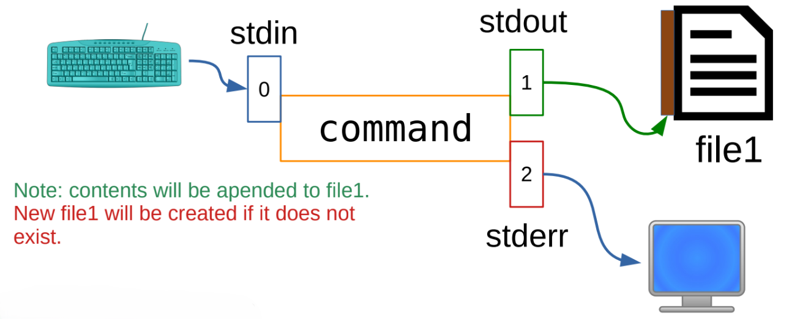
    </div>

3. **`command 2> file1`** : Using `2>` redirecting error to file1, again this will override the file1 if exists already, we can use `2>>` to appent to the file1.
    ```bash
    # Example
    ls -l /ETC/BIN 2> list_error.txt
    ```
    <div style="text-align: left;">
    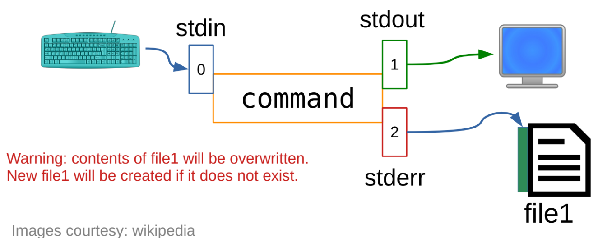
    </div>

4. **`command < file`** : Use `<` to take standard input of a command from a file
    ```bash
    # Example
    wc < list_error.txt
    ```
    <div style="text-align: left;">
    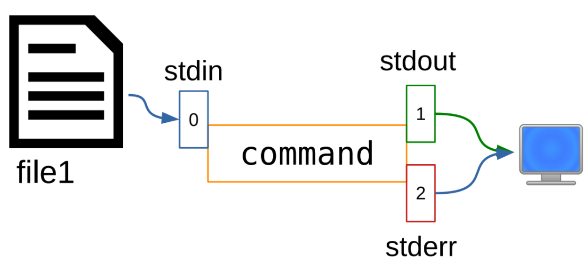
    </div>


5. **`command > file1 2> fiel2 `** : Using `>` to redirect output to file1, and `2>` to redirect error to file2.
    ```bash
    # Example
    ls -R $HOME /baba > list_file_rec.txt 2> error_file.txt
    ```
    <div style="text-align: left;">
    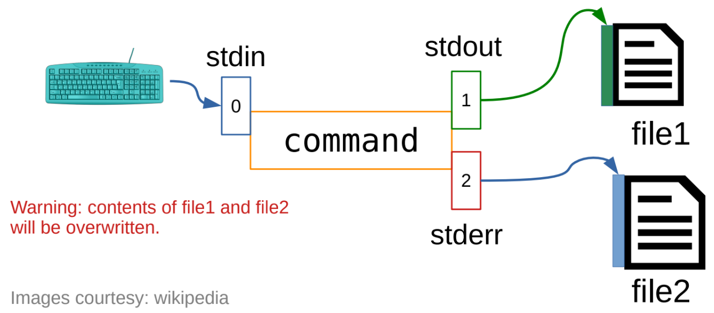
    </div>

6. **`command > file1 2>&1`** : Using `2>&1` we redirect error to standard out put which is using `>` is redirected to file1, In short use this whenever we need store both error and output.
    ```bash
    # Example
    ls -R $HOME /baba > output_file.txt 2>&1
    ```
    <div style="text-align: left;">
    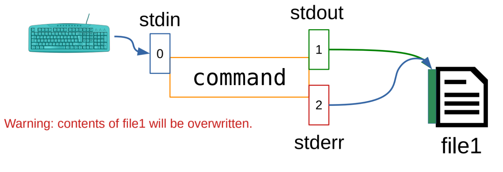
    </div>

7. **`command1 | command2`** : Using `|` **(Pipe)**, The pipe takes the standard output of the command on the left and sends it as the standard input (stdin) to the command on the right.
    ```bash
    # Example
    cat list_error.txt | grep "FATAL" 
    ps aux | grep node # lists all running processes on the system, and filters the list to show only the rows related to "node".
    command | sort | less # may be usefull for larg outputs
    ```
    <div style="text-align: left;">
    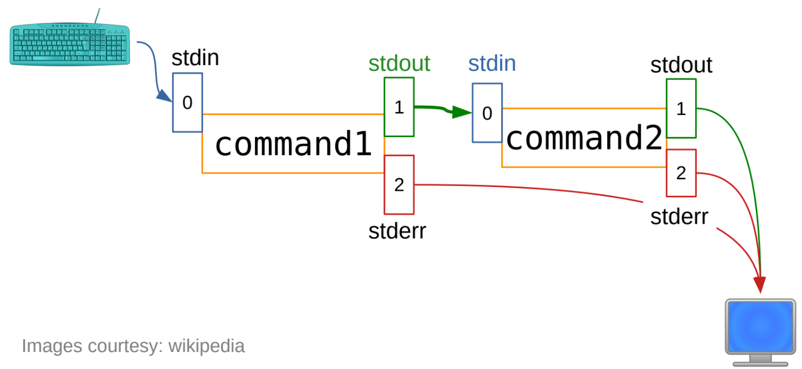
    </div>

8. **`command1 | command2 > file1`** : Similarly we can use all above like `2>`, `>>`, `command1 < file0 | command2 > file1 2>&1`, etc. 
    ```bash
    # Example
    ps aux | grep node > process_info.txt
    ```
    <div style="text-align: left;">
    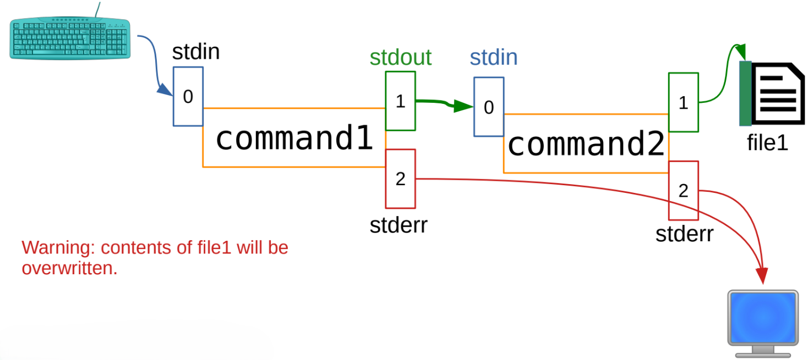
    </div>

## `tee` Command
The tee command in Linux is used to read from standard input and write the output simultaneously to both standard output (the terminal) and one or more files. It is particularly useful when you want to view the output of a command while also saving it to a file.
```bash
# Syntax
command | tee [OPTIONS] [FILE...]
# Example
ls -l /usr/bin > list_file.txt
ls -l /usr/bin > file1 file2 # both files have same content in it
```
<div style="text-align: left;">
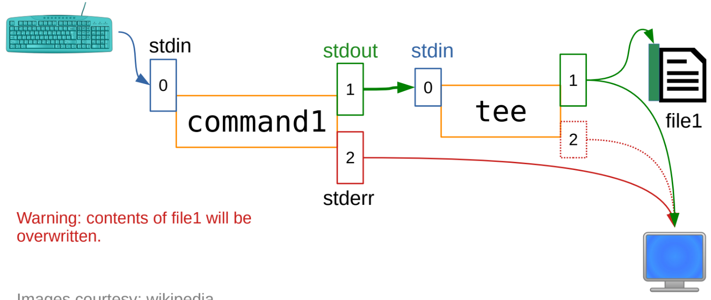
</div>

## Special directory `/dev/null`
The `/dev/null` is a special file in Linux, often referred to as a **black hole**. Any data written to it is discarded, making it useful for suppressing unwanted output or errors.
<div style="text-align: left;">
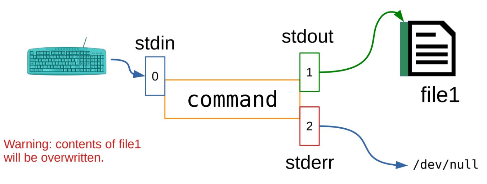
</div>

### How It Works:
- Writing to it (Discarding Data): Anything you send or redirect into `/dev/null` is instantly discarded and disappears forever. It consumes the data without saving it or using up disk space.
```bash
# Syntax
command 2> /dev/null 
command > /dev/null
# Example
ls $HOME /baba 2> /dev/null # only list directorys inside HOME do not show Error
ls $HOME /baba > /dev/null # only show the Error '/baba does not exist'
```
- Reading from it (Providing Nothing): If you try to read from `/dev/null`, it immediately returns an End-Of-File (EOF) marker, meaning it always looks completely empty.
    - Use Cases :
    1. Silent Execution: Run commands without displaying output `(> /dev/null)` or errors `(2> /dev/null)`.
    2. Log Cleaning: Clear logs without deleting files.
    3. Secure Deletion: Overwrite sensitive files with null bytes.
```bash
# Syntax
cat /dev/null > file
# Example
cat /dev/null > /var/log/syslog # clear logs
cat /dev/null > sensitive_file # delete its content
```

# Software Management (Using package management systems)
A package manager is a software utility that simplifies managing applications on Linux systems. It automates tasks such as installing, upgrading, configuring, and removing software packages while ensuring that all required dependencies are installed automatically. Packages are precompiled archives containing binaries, configuration files, and metadata like version, description, and dependencies, which the package manager uses to maintain system stability and consistency.

## Package Type
<div style="text-align: left;">
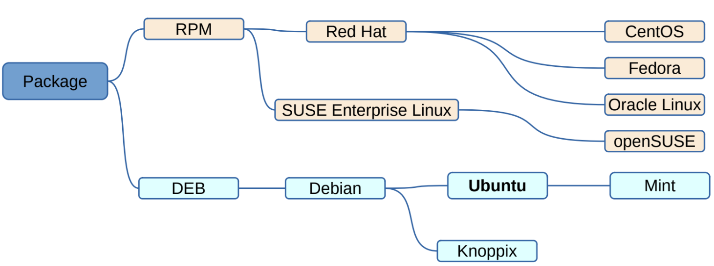
</div>

- Those who maintain Linux servers should be aware of `RPM` type.

### Package Name Convention
<div style="text-align: left;">
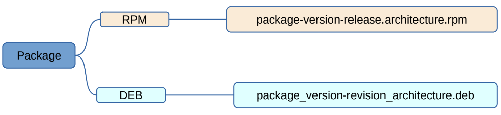
</div>

### Package Priorities
**Note** : These specific package priorities are exclusive to DEB (Debian-based) systems. They are part of the official Debian Policy Manual to help manage package dependencies and base installations. RPM-based distributions (like Fedora, RHEL, and CentOS) do not use these specific priority labels. Instead, RPM packages use Package Groups (such as Core, Base, Development, or Servers) to categorize and organize software.
| Priorities | Description |
| --- | --- |
| `required` | essential to proper functioning of the system |
| `important` | provides functionality that enables the systemto run well |
| `standard` | included in a standard system installation |
| `optional` | can omit if you do not have enough storage |
| `extra` | could conflict with packages with higher priority,has specialized requirements, install only if needed |

## Architectures
<div style="text-align: left;">
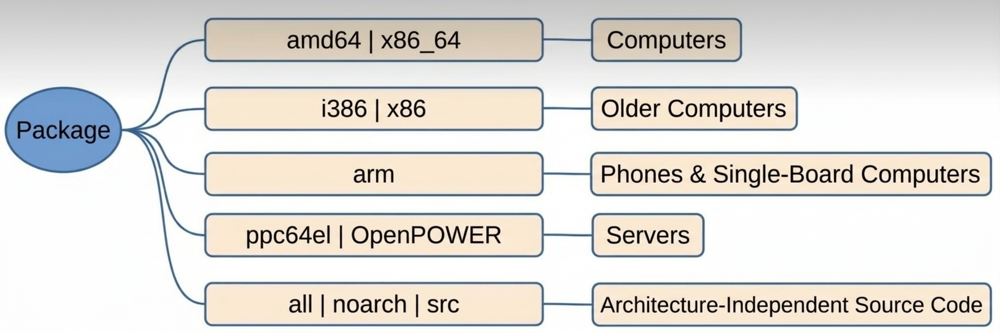
</div>

## Tools
<div style="text-align: left;">
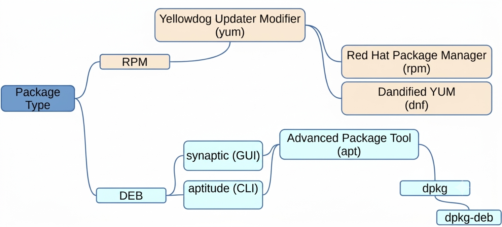
</div>

## Package management Using `apt`
APT stands for Advanced Package Tool — a powerful package management system used primarily on Debian and its derivatives like Ubuntu. It provides a high-level command-line interface for installing, updating, upgrading, and removing software packages, along with managing their dependencies efficiently.
### Inquiring package db
The APT cache in Linux stores package metadata and downloaded .deb files, allowing you to query, inspect, and manage software packages efficiently on Debian-based systems.

1. `apt-cache search keyword` : Search packages for a keyword
    ```bash
    apt-cache search fortune
    ```
2. `apt-cache pkgnames` : List all packages that are on system, with `apt-cache pkgnames <match>` show only those which matches the string in `< >`.
    ```bash
    apt-cache pkgnames # lsit all packages
    apt-cache pkgnames nm # show only packages with name 'nm'
    ```
3. `apt-cache show -a package_name` : Display package_name records of a package_name, i.e shows detailes of a particular package.
    ```bash
    apt-cache show -a nmap # Display info about nmap packages (like Priorities, Filename, etc)
    ```

## Package sections
- To know what all package avilable visit `https://packages.ubuntu.com/<nick_name>`, find nick name using `lsb_release -a` command.
- Like for [noble](https://packages.ubuntu.com/noble)
<div style="text-align: left;">
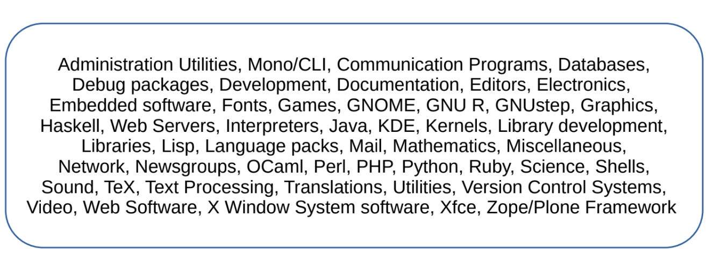
</div>

## Checksum (Check the Authenticity of a package)
- `md5sum`
- `sha1sum`
- `sha256sum`

```bash
gphani@icme:~$ echo "This file is edited by Phanikumar." > file1.txt # P'h' in Phanikumar
gphani@icme:~$ echo "This file is edited by Pnanikumar." > file2.txt # P'n' in Pnanikumar
gphani@icme:~$ cat file1.txt file2.txt
This file is edited by Phanikumar. # Looks similar
This file is edited by Pnanikumar.
gphani@icme:~$ md5sum file1.txt
9c62abf2db2c605f3fba2df282c3c92e  file1.txt
gphani@icme:~$ md5sum file2.txt
c696deed0a831c9cc054266a53678f2c  file2.txt
gphani@icme:~$ sha1sum file1.txt
f307de66f5abf2a01b0e71b23b850605eb54fe91  file1.txt
gphani@icme:~$ sha1sum file2.txt
f6c312dd5e1fb34f5f34603fc23277b00efbb82a  file2.txt
gphani@icme:~$ sha256sum file1.txt
585a55c7272d311b662e06e65f6b3bbc869e7ed419e7ff15999b360c95d0dce6  file1.txt
gphani@icme:~$ sha256sum file2.txt
04fd25f6495895bfbe4df8cd898349cdaed22f20176f9fb42729ec51720fd02d  file2.txt
```
### How it works
A checksum acts as a unique cryptographic fingerprint for a file.
- Generation: When Ubuntu creates an ISO image or a package, it runs the file through a hashing function, producing a fixed-length string of characters (the checksum).
- Distribution: Ubuntu publishes these official checksum values on their website alongside the download links.
- Verification: When you download the file, you run a command on your computer (like `sha256sum ubuntu-24.04-desktop-amd64.iso`) to generate a checksum for the file sitting on your hard drive.
- Comparison: If your calculated string matches the one published by Ubuntu down to the very last character, you can be 100% sure the file is complete, uncorrupted, and hasn't been tampered with. If even a single bit is altered, the resulting hash changes completely.

## Only Sudoers can install / upgrade & remove packages
Only Administrators can run the privileged command & case of Ubantu called **sudoers**.
- It is present in `/etc/sudoers` and also to read the file you must be listed in sudoers.
- If other users try to read sudoers file will not permitted to do so.
```bash
# with gust user
guest@icme:~$ sudo cat /etc/sudoers
[sudo] password for guest: 
guest is not in the sudoers file. This incident will be reported.
# with user in sudoers
gphani@icme:~$ sudo cat /etc/sudoers
[sudo] password for gphani:
# some content
root    ALL=(ALL:ALL) ALL
gphani  ALL=(ALL:ALL) ALL
nafiah  ALL=(ALL:ALL) ALL
# some content
```
- Also super user can find all the attempt for super user privileges by any other users (keept in log file `/var/log/auth.log`)
```bash
# Only super users can read it
gphani@icme:~$ sudo tail -n 100 /var/log/auth.log
```
## Installation / Updation of packages
When we try to install a package,the system knows from which website these packages have to be downloaded for installation and this information is stored in `/etc/apt`.

- In `/etc/apt` look for two files, One is folder `sources.list` and other is directory `sources.list.d` (well in my VM `sources.list` show moved to Ubuntu sources have moved to `/etc/apt/sources.list.d/ubuntu.sources`)

- `/etc/apt/sources.list` : serves as the primary configuration file that defines the core software repositories for Debian-based systems. It stores the essential archive URLs, distribution codenames, and repository components (such as free, proprietary, or community-supported software classifications) needed to fetch official operating system packages, security patches, and system updates.

- `/etc/apt/sources.list.d` : operates as a modular, drop-in directory where individual software applications, PPAs, and third-party repositories store their own separate configuration files. Instead of modifying the main file, external software management tools add isolated list files here, allowing APT to read them seamlessly while keeping third-party package sources cleanly organized and easily removable.

### Fetching the Updates (`sudo apt-get update`)
When you run the command `apt-get update` as a super user it would contact the package management system apt-get, which contact the repositories for any updates that are avilable for any of the packages, and fetches those updates and keeps them in the cache.

### Upgrade packages (`sudo apt-get upgrade`)
Firstly we run `update` to fetch all the updates and then run `upgrade` to upgrade the packages on the system.

### `install` & `reinstall` packages
- `sudo apt-get install package_name` : command downloads and installs a specified software package along with all its required dependencies, or updates an already installed package to its latest available version (same as `sudo apt install`).
- `sudo apt-get reinstall package_name` : command forces the package management system to download and reinstall a package that is already present on your system, which is typically used to repair corrupted files, missing configuration scripts, or broken dependencies without altering user configuration data.

## Removing & Cleaning up
- `sudo apt-get autoremove` automatically detects and deletes leftover packages and dependencies that were installed automatically to support other software but are no longer needed by any active program, freeing up disk space.
- `sudo apt-get remove package_name` uninstalls the specified software package, but leaves its configuration files intact on the system so that your personal settings are preserved if you decide to reinstall it later.
- `sudo apt-get purge package_name` completely uninstalls the specified package and forcefully deletes all of its associated configuration and preference files, ensuring a completely clean removal from the system.
- `sudo apt-get clean` clears out the local repository cache by deleting all downloaded .deb package files stored in /var/cache/apt/archives/, reclaiming storage space used by previously installed or updated packages.

## Packages Managment Using `dpkg`
**NOT RECOMENDED UNLESS YOU KNOW WHAT YOU ARE DOING**

It is the foundational, low-level package management system for Debian-based Linux distributions. Its primary job is to install, remove, build, and manage individual `.deb` software packages.

- Unlike higher-level tools like `apt` or `apt-get`, `dpkg` **does not** automatically resolve or download dependencies from remote repositories over the network. It operates strictly on local files, serving as the underlying engine that `apt` calls to perform actual package installations and removals.

---

### What is Stored in `/var/lib/dpkg/`

The `/var/lib/dpkg/` directory is the administrative core and database hub where `dpkg` tracks everything happening to software packages on your system.

Here is a breakdown of the key files and folders stored inside it:

- **`arch` File:** A simple text file that stores the host system's native CPU architecture (for example, `amd64` or `arm64`). It tells `dpkg` which architecture-specific packages are compatible with the system.
- **`status` File:** The master database file that maintains a real-time record of every package on the system, tracking whether it is installed, unpacked, half-configured, or purged, along with its version, dependencies, and maintainer details.
- **`info/` Directory:** A critical folder containing metadata for every installed package. Inside, you will find:
    -  **`.list` files:** Exact lists of every file installed by each package, allowing the system to know precisely what files to delete during uninstallation.
    -  **`.conffiles` files:** Lists of configuration files managed by packages.
    - **`.md5sums` files:** Gives the md5sum for all files present in diffeerent locations (which is mentioned in `.list` file)
    -  **Maintainer Scripts:** Shell scripts (`preinst`, `postinst`, `prerm`, `postrm`) executed automatically before or after a package is installed, upgraded, or removed.

- **`available` File:** A registry listing packages known to the system from active repository sources.
- **`updates/` Directory:** A temporary staging area where `dpkg` writes transactional database updates while installing or upgrading packages to prevent database corruption if an interruption occurs.
- **`triggers/` Directory:** Tracks deferred system tasks—such as updating desktop application menus, shared library links, or font caches—so they can run efficiently in batches after package operations finish.
- **`alternatives/` Directory:** Manages data for the `update-alternatives` system, which handles default commands when multiple packages provide the same functionality (such as choosing your default text editor).
### Using `dpkg`
- `dpkg -l pattern` : searches and displays a list of packages whose names match a specific wildcard or text pattern, showing whether they are installed, removed, or available.
- `dpkg -L package` : lists every individual file path that was installed on your system by a specific package, allowing you to see exactly where its files reside.
- `dpkg -s package` : reports the detailed status of a specific package, displaying its installation state, version, maintainer, description, and dependency information (same as `apt-cache show package` ).
- `dpkg -S path` : performs a reverse search through the package database to find which installed package owns a specific file path or filename.
- `dpkg-query` : A powerful tool used to query the dpkg database for information about packages installed on the system.
```bash
dpkg-query -W -f='${Section} ${binary:Package}\n' | sort | less
dpkg-query -W -f='${Section} ${binary:Package}\n' | grep shells 
```
- `dpkg -i` : Using this command we can install deb packages but it is recomended to do such things using **PACKAGE MANAGMENT SYSTEM** only. 

# Starting and Managing Processes
Normally, when you run a command in the terminal, your shell blocks (waits) until that command finishes before giving you the prompt back & we are going to look for situations where a task is running for long time and we want to bring back the control to command prompt either by kill or suspend the tasks (we use `sleep` command for illustration).

Processes can be started in two ways:
- **Foreground Processes**: These run interactively, receiving input from the keyboard and sending output to the screen, shell blocks until finishes for other.

- **Background Processes**: These run without blocking the terminal, allowing other commands to execute simultaneously.
    1. Using `command &`, start a process in the background.
    2. Using `coproc`, Runs a co-process

**Remember** :
If we try `man` with a shell (built-in) feature, there is no manual so use `help command` for info. 
## Using `command &`
The ampersand `&` (Background) Operator is placed at the end of a command to run it in the background asynchronously. By adding &, the shell immediately spawns the command as a background job, returns the prompt to you instantly, and lets you continue typing other commands in the same terminal.

**Key characteristics :**
- Non-interactive output : The background process still writes to your terminal screen by default unless its input/output is redirected.
- Job Control : The shell assigns it a job number (e.g., [1]) and a Process ID (PID). You can bring it back to the foreground using `fg`, check its status using `jobs`, or terminate it using `kill`.
    ```bash
    # Example:
    sleep 60 &
    ```
## Using `coproc` command
It is a built-in shell command used to run a concurrent asynchronous process  (like &), but with a crucial difference: it sets up a two-way communication pipe (bidirectional IPC) between the parent shell and the background command (use `help coproc` to know more).

**How it works :**
It automatically creates two anonymous pipes—one to send data into the coprocess's standard input, and one to read data out of its standard output. This allows your script or interactive shell session to feed data to a background program and read its responses dynamically.

**Key characteristics :**
- Named Coprocesses: You can name your coprocess (e.g., `coproc MYPROC { command; }`). If you don't name it, the shell defaults to naming it **COPROC**.

- File Descriptors: The shell automatically assigns file descriptors to read from and write to the coprocess, stored in shell variables.These file descriptors can be used with standard shell commands and redirections to interact with the coprocess.

    - `${COPROC[0]}` : connected to the coprocess's **stdout** (read from the main shell)
    - `${COPROC[1]}` : connected to the coprocess's **stdin** (write from the main shell)
    ```bash
    coproc bc # Runs a basic calculator in background
    echo "5 + 5" >&${COPROC[1]}
    read -r result <&${COPROC[0]}
    echo "$result"
    ```

## Kill Process
1. `Ctrl+c` (Interrupt Signal)

`Ctrl+c` is a keyboard shortcut used in the terminal to send an interrupt signal (SIGINT, signal number 2) to the process currently running in the foreground.

- Graceful Termination: This is designed as a polite request to stop. It tells the program, "Please clean up your temporary files, close your network connections, and exit safely.", 
- Because it relies on the application choosing to handle the signal, a poorly written or frozen program can ignore `Ctrl+c` completely if it doesn't have a handler set up for SIGINT.

2. `kill -9 PID` (Force Kill)

The `kill` command sends signals to processes, and specifying `-9` sends the SIGKILL (Signal 9), Unlike `Ctrl+c`, SIGKILL is sent directly to the **Linux kernel**, not to the application itself.

- Immediate, Unconditional Termination: The kernel stops the process instantly. The application is given no chance to clean up, save data, or release resources. It is wiped from the process table immediately, Because the application cannot catch, block, or ignore SIGKILL, it will always work—even if the program is completely frozen or unresponsive to Ctrl+c.
- Drawbacks: Using `kill -9` can lead to data loss or corrupted files if the application was in the middle of writing data, because it doesn't get a chance to perform graceful shutdown routines.

## Suspend Process
1. Using `Ctrl+z` (Interactive Foreground Process)
If you are running a command directly in your terminal and it is currently occupying the foreground. Press `Ctrl + z`, This sends the TSTP (Terminal Stop) signal to the foreground process, instantly suspending it and returning you to the shell prompt (The shell marks it as a "Stopped" background job)

2. Using `kill -19 PID` or `kill -STOP PID` (By Process ID)
If a process is running in the background or in another terminal, you can suspend it using its Process ID (PID).

- Signal 19 (or STOP) pauses the execution of the process immediately. The process remains in memory, but the kernel stops giving it CPU time.

### View suspended process
- `jobs` : It is a shell built‑in (e.g., in Bash) that displays background and suspended jobs in the current terminal session, showing their job IDs, states (Running, Stopped, Done), and associated commands (use `-l` for PIDs, for more use `help jobs`, note `man` will not work).

## Resume a stoped/suspended process
To resume a suspended (paused) process in Linux, the method depends on whether you want to bring it back to your active terminal (foreground) or keep it running in the background.

1. Using `fg` or `fg %job_num` (Bring to Foreground)

If you suspended a process in your current terminal session (using `Ctrl + z`), it is currently stored as a stopped background job Or if you have multiple background jobs, specify the job number like `fg %1` (otherwise forground the least suspended job only)
- It brings the suspended process back to the active foreground and resumes its execution immediately, allowing you to interact with it again.
```bash
fg # foreground the least suspended job
fg %2 # foreground the job with job no. 2
```

2. Using `bg` or `bg %job_num` (Resume in Background)

If you suspended a process with current terminal session and want it to continue running use `bg` Or if you have multiple background jobs, specify the job number like `bg %1`, but losse terminal prompt upto process completion.
```bash
bg # resume the least suspended job in background
bg %2 # resume the job with job no. 2 in background
```

3. Using `kill -18 PID` or `kill -CONT PID` (Resume by PID)

If you suspended a process using its Process ID (PID) with `kill -STOP` (or `kill -19`), you cannot use `fg` or `bg` unless it belongs to your shell's current job list. Instead, you resume it using the Continue signal, Signal 18 (or CONT) tells the kernel to wake the paused process back up and resume its execution.


## Bash Special Parameters & Shell Execution Analysis
**Key Concepts & Special Variables**

1. **`$-` (Current Shell Flags) :**
Displays the set of option flags currently active in the Bash shell session.
    - `h` : Hash commands (remembers location of commands).
    - `i` : Interactive shell mode.
    - `m` : Monitor mode (job control enabled).
    - `B` : Brace expansion enabled.
    - `H` : History expansion enabled (!).
    - `s` : Read commands from standard input.
    - `c` : Commands read from the first non-option argument string.

2. **`$$` (Process ID of Current Shell) :**
Returns the Process ID (PID) of the main parent Bash instance executing the commands.

```bash
gphani@icme:~$ echo $-
himBHs # current shell options
gphani@icme:~$ man bash # know what each 'himBHs' means
gphani@icme:~$ bash -c "echo \$-" # Spawns a new instance of Bash 
hBc # Spawned bash is non-interactive subshells, lack terminal job control, and don't load history flags.

gphani@icme:~$ echo $$ # prints the PID of current shell
3423 # PID of current shell
gphani@icme:~$ bash -c "echo \$$; echo \$-; ps --forest"
11213
hBc
  PID TTY          TIME CMD
 3423 pts/0    00:00:00 bash
11213 pts/0    00:00:00  \_ bash
11214 pts/0    00:00:00      \_ ps
```
3. `history` : It is a built-in feature that records the commands you type into the terminal, allowing you to easily view, search, reuse, and manage past commands without retyping them.
```bash
history # list all commands used in few privous days.
# Example history
1390    ls -l
1391    ps --forest -la
!command_num # runs that command 
!1391 # runs ps --forest -la
```
### Brace Expention (Detailed in week 4)
```bash
gphani@icme:~$ echo $-
himBHs # Here 'B' for Brace expansion enabled
gphani@icme:~$ echo {a..z}
a b c d e f g h i j k l m n o p q r s t u v w x y z
gphani@icme:~$ echo {A..D}{A..D}
AA AB AC AD BA BB BC BD CA CB CC CD DA DB DC DD
gphani@icme:~$ echo * # wildcards *
Desktop Documents Downloads file1 MOOC-OnlineBSc Music Pictures Public snap Templates Videos
```
## Exit Status (or Return Code) Using `echo $?`
In Bash, `echo $?` is a command used to print the exit status (or return code) of the **most recently executed command**.

**How It Works:**
When any command or script finishes running, it returns an integer value to the shell:
- `0` : Indicates success (the command executed without any errors).   
- Non-zero (typically `1 to 255`): Indicates failure or some type of error, with different numbers representing different error codes.
- `exit` : when you run a command and it encounters an `exit 300` instruction (often inside a shell script), it terminates the process and passes 300 as the exit status code to the parent process or shell.
    - If a script executes `exit 300`, a parent process checking the raw exit (undergo modulo 256) status will typically see 44 .

# Extra commands
- `lsb_release -a` : displays distribution‑specific information such as Distributor ID, Description, Release number, Codename, and LSB version, with `-a` shows all info (also `Codename` is nick name make it easy to search for package). It reads data from files like `/etc/lsb-release` and is available by default on many distributions or via packages.

- `uname -a` : The uname command in Linux is used to display system information such as the kernel name, version, hardware architecture, and operating system.

- `fortune` : Entertainment for programer on CLI (The fortune command displays a random quote, joke, or piece of advice in your terminal).

- `sleep` : Used to pause the execution of a script or command for a specified duration (gives the time delay).

- `bc` : A command‑line calculator that supports interactive calculations, scripting, variables, and advanced math functions via the `-l` math library. It uses C‑like syntax and can perform operations such as addition, division, exponentiation, trigonometric functions, and base conversions.